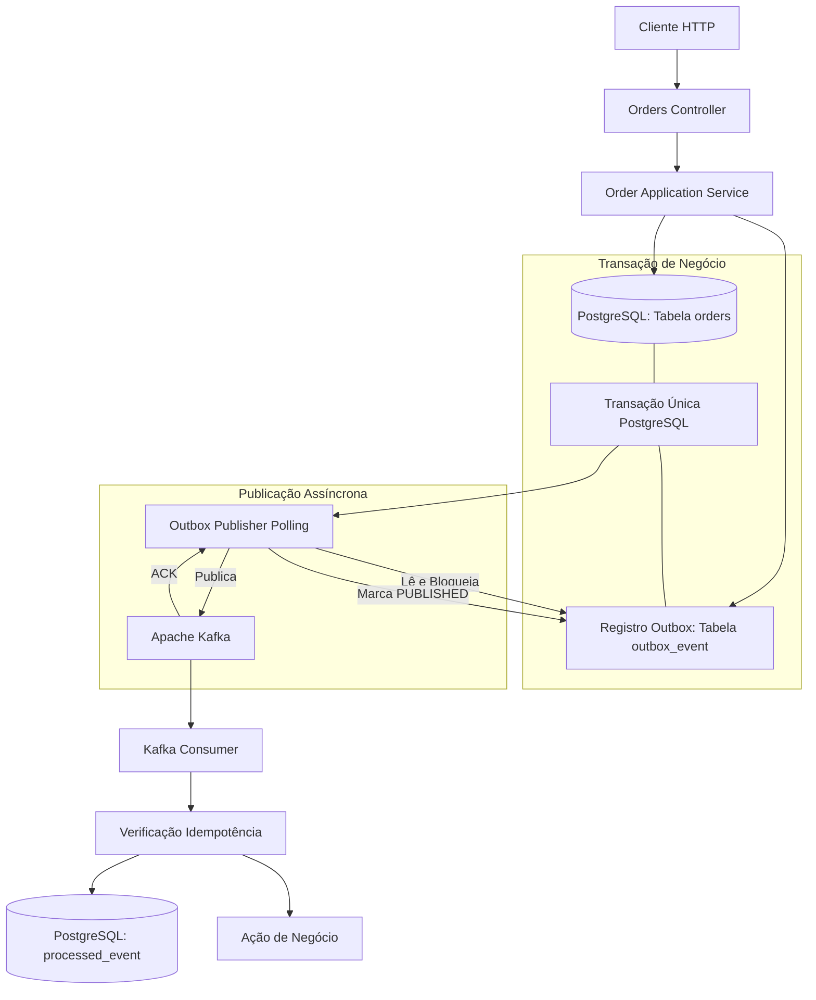

# Transactional Outbox Pattern com Spring Boot, PostgreSQL e Apache Kafka

Projeto demonstrativo completo aplicando o padrão arquitetural **Transactional Outbox Pattern** com Java 21, Spring Boot 3.3, Spring Data JPA, PostgreSQL e Apache Kafka.

## 1. Problema Resolvido: Dual Write

Em arquiteturas orientadas a eventos e microsserviços, é comum precisar atualizar o banco de dados relacional e enviar uma notificação para um message broker (como Apache Kafka). Sem uma transação distribuída (que introduz alto acoplamento e degrada a performance), a tentativa de realizar duas operações separadas introduz o risco de:

- **Inconsistência por falha no broker:** O registro é commitado no banco relacional, mas a publicação falha por indisponibilidade do Kafka ou erro de rede.
- **Inconsistência por falha no banco:** O evento é publicado no broker, mas o commit no banco de dados sofre rollback.

O **Transactional Outbox Pattern** resolve esse problema garantindo que a atualização do estado de negócio e o registro do evento ocorram na **mesma transação do PostgreSQL**.

## 2. Fluxo Arquitetural



## 3. Tecnologias Utilizadas

- **Java 21 LTS**
- **Spring Boot 3.3.4**
- **Spring Data JPA & Hibernate**
- **Flyway** (Gerenciamento e Versionamento de Banco de Dados)
- **PostgreSQL 16**
- **Apache Kafka (KRaft mode)**
- **Testcontainers** (PostgreSQL & Kafka)
- **Docker & Docker Compose**

## 4. Executando Localmente

### Pré-requisitos
- Docker & Docker Compose
- Java 21 LTS
- Maven 3.9+

### Subindo a Infraestrutura
```bash
docker-compose up -d
```

### Compilando e Executando Migrations
```bash
mvn clean compile
```
